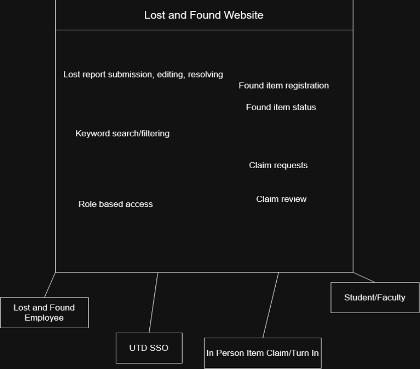
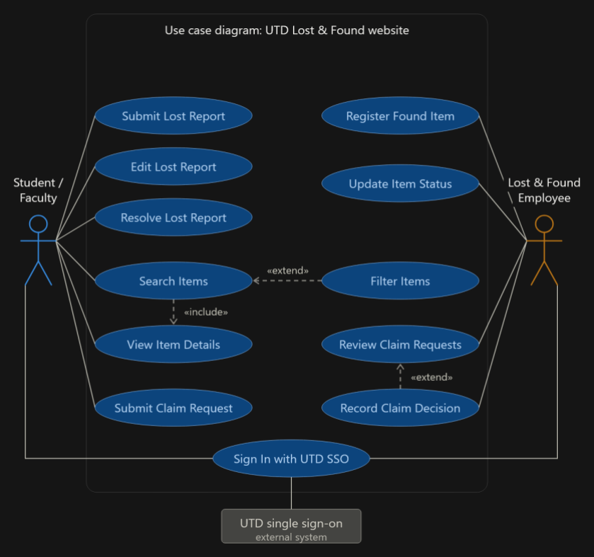

**CE / CS / SE 3354  ·  SOFTWARE ENGINEERING  ·  FALL 2026** 

# **Project Deliverable P1** 

## **Proposal and Requirements — Team Template** 

Weight 4%  ·  Due Sunday 18 October 2026, 11:59 PM Central  ·  Submit one PDF per team on Canvas 

|**Field**|**Your entry**|
|---|---|
|Project title|UT Dallas Lost and found system|
|Team number and section|Team 5 Section 5|
|Team members (name · net ID)|Michael Makhlouf-mrm230010, Jacob Zepeda-dal637778, Dylan Henson-dal230038, Kellen Widhelm-kcw230001, Jin Jeong-sxj190081, Muneer Bradost-dal176525, Jay Esquivel Savage-jxe240003|
|Repository URL|https://github.com/ElectronCarrot/SE-Lost_And_Found|
|Document version|0.1|
|Date|10/18/2026|

## **0   Revision History and Contribution Record** 

Both tables below are graded. The contribution record carries the individual 20% of this milestone and must be consistent with your repository history. 

|**Version**|**Date**|**Author**|**Summary of change**|
|---|---|---|---|
|0.1|10/9/26||Initial baseline for P1|

### **0.1   Individual contribution record** 

|**Team member**|**What this person produced for P1**|**Evidence in the repository**|
|---|---|---|
|Michael Makhlouf|Section 2.1, 2.3, 2.4, 2.5, 3.5, 4.4||
|Jacob Zepeda|Section 1.3 (Definitions), presented the project idea to the team||
|Dylan Henson|Sections 1.2, 2.2, 3.4, 4.1, 4.3||
|Jin Jeong|Section 3.1, 3.2, 3.3||
|Kellen Widhelm|Sections 2.3, 4.1||
|Muneer Bradost|1.1, 1.2, 1.3, 3.1, 1.4, 4.2||
|Jay Esquivel Savage|Completed Section 5 (Open Questions)||

## **1   Introduction** 

### **1.1   Purpose of this document and of the system** 

This document is a proposal for a UTD Lost and Found website. In this proposal, we will highlight what problems this project will solve, the scope of the project, constraints, assumptions, feasibility, and detailed requirements. This proposal is for the UTD police department which oversees the campus lost and found. 

This project is meant to help students and faculty of UTD find their lost items more efficiently. With this website, they will be able to search for their lost item and see if it has been given to the lost and found. This allows them to check without having to physically go to the location. 

### **1.2   Scope** 

|**In scope — we will build this**|**Out of scope — we will not, and why**|
|---|---|
|A user interface for UTD students and faculty|Creating student, faculty, and lost and found employee accounts: Every student and faculty member of UTD already has an associated school account.|

|**In scope — we will build this**|**Out of scope — we will not, and why**|
|---|---|
|A data base for inputting what is found|Not making an app version. To keep it in ab reasonable time frame we will start by making it a website.|
|An interface for the police department to input what was found|Delivering the items outside of the police station. You will have to go pick them up yourself. We are just making a way to see if we have what you lost and other features.|
|A way for student and faculty to report and search in the data base, for something missing|We are only making it accessible to UTD students and faculty. We do not want people who have never been to the university to claim items that are not theirs.|

Only people attending or working at UTD will have access, so there is no need to create another account when they already have one with the university. Users will likely not want to download an app for such a simple function. 

### **1.3   Definitions, acronyms and abbreviations** 

|**Term or abbreviation**|**Meaning as used in this project**|
|---|---|
|Match|A link between a lost report and a found item|
|Lost Report|A student’s or faculty’s report of an item they are missing|
|Found Item|An item found by someone on campus which is now being stored at the police station|
|UTD NetID|Existing university account that is used to login|
|Seeker|A user that has lost an item and is looking for it|

### **1.4   References** 

[R1] University of Texas at Dallas. UTD website and university information. https://www.utdallas.edu/ 

[R2] University of Texas at Dallas. University account and login information (Single Sign-On). 

[R3] ISO/IEC/IEEE 29148. Requirements Engineering standard, used as a guide for organizing this document. 

## **2   Overall Description** 

### **2.1   Product perspective and context** 

Everything inside the boundary involves systems we must design for this website, while everything outside the boundary is something that we will rely on. We will be using the UTD single sign on service, and we will be relying on the already existing in person item claim/turn in service. Our website will help supplement the process but not replace it. 

### **2.2   Stakeholders and how you reached them** 

|**Stakeholder**|**Role in relation to the system**|**What they need from it**|**How you learned this**|
|---|---|---|---|
|Students/faculty|seeker|Friendly interface|We assumed|
|Lost and found Employee|user|Able to input items the data base|We assumed|
|UTD Police budget|Owner/client|Lost operations cost|We assumed|
|keeper||||

### **2.3   User characteristics** 

Student or Faculty: A student or faculty member of UTD that has lost an item. They cannot be assumed to already know how to use the website, so the user interface must be simple to understand and walk them through the process. They could be using a mobile phone or a laptop, or desktop computer. 

Lost and Found Employees: An employee working for the UTD police department lost and found. They will use a desktop computer for work. Employees will be expected to use the system daily and to be taught how to use it by another employee. 

### **2.4   Constraints** 

- We will use the existing campus single sign-on service. All our users should already have an existing UTD account, this also provides additional security which prevents outsiders from using the website. 

- Users need an internet connection, and a web browser. To access the website, users must have these. 

- Photos stored without using a third party service 

### **2.5   Assumptions and dependencies** 

|**#**|**Assumption or dependency**|**What breaks if it does not hold**|
|---|---|---|
|A1|Students/Faculty and Employees already have a UTD SSO|These users will not be able to access the website|
|A2|Employees of lost and found already have an in person claim process|Users will not be able to claim their items|
|A3|Found items are physically held at the UTD police station|Students/Faculty will not be able to claim their items in person|

### **2.6   Feasibility summary** 

|**Feasibility gate**|**Verdict**|**Evidence behind the verdict**|
|---|---|---|
|Technical|Feasible|We are making a website and database with simple functionality.|
|Operational|Feasible|Students on campus want an easy way to track down their lost items.|
|Schedule|Feasible|A basic version can be finished as long as we prioritize essential functions.|
|Economic / resource|Feasible|Development costs are low, as we are developing it ourselves. There would be a low cost for database services.|
|Legal|Feasible|Feasible, as long as the website follows privacy laws and university policies|

## **3   Specific Requirements** 

### **3.1   Functional requirements** 

|**ID**|**Requirement — one “shall” sentence**|**Priority**|**Source**|**Acceptance criterion**|
|---|---|---|---|---|
|FR-01|The system shall authenticate students, faculty, and Lost and Found employees through UTD Single Sign-On.|MUST|Students/fac ulty; Lost and Found employees|A tester with a valid UTD account can sign in, while a tester without valid UTD credentials cannot access authenticated functions.|
|FR-02|The system shall allow a student or faculty member to submit a lost report containing an item category, description, date lost, and last-known location.|MUST|Students/fac ulty|A tester can submit a report only after completing all four required fields, and the report appears in the user’s report list.|
|FR-03|The system shall allow a student or faculty member to edit an unresolved lost report that they created.|SHOULD|Students/fac ulty|The report owner can change a field and see the saved change after reloading the report.|

CE / CS / SE 3354  ·  Fall 2026  ·  Project Deliverable P1 — Proposal and Requirements 

|**ID**|**Requirement — one “shall” sentence**|**Priority**|**Source**|**Acceptance criterion**|
|---|---|---|---|---|
|FR-04|The system shall allow a student or faculty member to mark their lost report as resolved.|SHOULD|Students/fac ulty|The report owner can mark a report resolved, after which it no longer appears among active reports.|
|FR-05|The system shall allow a Lost and Found employee to register a found item with its category, description, date found, storage location, and public photograph.|MUST|Lost and Found employees|A tester using an employee account can enter all required fields and retrieve the saved item record.|
|FR-06|The system shall allow a Lost and Found employee to update the status of a found item to available, claimed, or disposed.|MUST|Lost and Found employees|Each permitted status can be selected and remains saved after the record is reloaded.|
|FR-07|The system shall allow authenticated users to search available found items by keywords.|MUST|Students/fac ulty|A search using a word contained in a test item’s public description returns that item.|
|FR-08|The system shall allow authenticated users to filter available found items by category, date range, and found location.|MUST|Students/fac ulty|Applying each filter returns only test records that satisfy every selected filter.|
|FR-09|The system shall display the public details of a found item without displaying its storage location or claimant information.|MUST|Students/fac ulty; UTD Police|A student account can view the public description, category, date, general found location, and photograph but cannot view restricted fields.|
|FR-10|The system shall allow a student or faculty member to submit a claim request for an available found item.|MUST|Students/fac ulty|A tester can submit one claim request for an available item and receives a visible confirmation.|
|FR-11|The system shall allow a Lost and Found employee to review pending claim requests for each found item.|MUST|Lost and Found employees|An employee account can open a found- item record and see every pending claim request associated with it.|
|FR-12|The system shall allow a Lost and Found employee to record the final disposition of a claim request as approved or rejected.|MUST|Lost and Found employees|An employee can select either outcome, and the selected outcome remains saved after reloading.|

### **3.2   Quality requirements** 

|**ID**|**Requirement — with threshold, condition and** **method**|**Priority**|**Source**|**How it will be verified**|
|---|---|---|---|---|
|QR-01|At least 95% of search requests shall display results within 2 seconds under a load of up to 50 concurrent users.|MUST|Students/fac ulty|Execute 100 timed searches during a 50- user load test and examine the recorded response times.|
|QR-02|The system shall maintain at least 99% availability during the published service hours, measured over each calendar month and excluding announced maintenance.|SHOULD|UTD Police|Review automated uptime-monitoring records for a one-month test period.|
|QR-03|A first-time user shall be able to submit a complete lost report within 3 minutes without assistance.|SHOULD|Students/fac ulty|Conduct a usability test with at least five representative users and time each successful submission.|

CE / CS / SE 3354  ·  Fall 2026  ·  Project Deliverable P1 — Proposal and Requirements 

|**ID**|**Requirement — with threshold, condition and** **method**|**Priority**|**Source**|**How it will be verified**|
|---|---|---|---|---|
|QR-04|Every page used by students, faculty, or employees shall satisfy WCAG 2.2 Level AA criteria evaluated by an automated accessibility scanner and manual keyboard- navigation test.|MUST|Students/fac ulty|Scan all user-facing pages and manually complete each primary workflow using only a keyboard.|
|QR-5|The system shall prevent a student or faculty account from accessing another user’s non-public report or claim data in 100% of authorization test cases.|MUST|UTD Police|Run positive and negative authorization tests for every protected endpoint and confirm that all unauthorized requests are denied.|
|QR-6|The system shall preserve 100% of successfully submitted lost reports, found- item records, and claim decisions after an application restart during persistence testing.|MUST|UTD Police|Create a predefined test dataset, restart the application, and compare every stored record and field with the original dataset.|

### **3.3   Constraint requirements** 

|**ID**|**Constraint — one sentence**|**Source**|**Why it cannot be negotiated**|
|---|---|---|---|
|CON-01|The system shall use the university-approved UTD Single Sign-On service for user authentication.|Section 2.4; UTD Police|The team does not control university identities, and separate account creation is outside the agreed scope.|
|CON-02|The system shall operate through a standards- compliant web browser without requiring installation of a native mobile or desktop application.|Section 1.2; Section 2.4|Native application development is explicitly outside the P1 project scope.|
|CON-03|The system shall permit access to authenticated functions only while the user has an active internet connection.|Section 2.4|The application depends on the remote authentication service and central database.|

### **3.4   Initial use cases** 

|**Field**|**Content**|
|---|---|
|Identifier and name|UC-01**submitting**claim to an item|
|Primary actor|Student/Faculty|
|Supporting actors|Lost and found Administrator|
|Preconditions — what must be true before it starts|An item must exist in the database and can be searched for, student/faculty is signed in|
|Trigger — what starts it|When the Student/Faculty finds an item in the database and summits a claim that it's theirs|
|Main success scenario — numbered steps|1-search database 2- submits claim 3-claim verified 4-listings altered 5-item picked up|
|Alternative and exception flows|1-student submits claim 2- claim denied 3-listing stay same|
|Postconditions — what is true when it succeeds|The lost and found admin reviews a claim|
|Requirements realised|FR-  a way to review claims|

|**Field**|**Content**|
|---|---|
|Identifier and name|UC-02 Reporting a lost item|
|Primary actor|Student/Faculty|
|Supporting actors|Lost and Found Administrator|

|**Field**|**Content**|
|---|---|
|Preconditions — what must be true before it starts|There must be a lost item|
|Trigger — what starts it|A student/faculty submits a lost item claim|
|Main success scenario — numbered steps|1-report a missing item 2-search the database and find do not find the item 3-report is seen by system 4- admin put into data base the missing item 5- notification sent to user|
|Alternative and exception flows|1-report a missing item 2-search the database and find item 3-claim lost item|
|Postconditions — what is true when it succeeds|The user is notified that the item has been put in the lost and found|
|Requirements realised|FR-  a way so check if there is a lost report submitted for the item that is being entered to the data base|

### **3.5   Requirements to use case traceability** 

|**Requirement ID**|**Use case(s) that realise it** **If blank — why, and what you will do**|
|---|---|
|FR-01|Sign in with UTD SSO|
|FR-02|Submit lost report|
|FR-03|Edit lost report|
|FR-04|Resolve lost report|
|FR-05|Register found item|
|FR-06|Update item status|
|FR-07|Search items|
|FR-08|Filter items(extends Search items)|
|FR-09|View item details(included by Search items)|
|FR-10|Submit claim request|
|FR-11|Review claim requests|
|FR-12|Record claim decision(extends Review claim requests)|

## **4   Project Plan** 

### **4.1   Team roles and working agreement** 

|**Team member**|**Role for P1 to P2**|**How the team makes a decision when it disagrees**|
|---|---|---|
|Dylan Henson|P1- working to get communication started and 3.4 done|Communication to find the way we want to answer the problems.|
|Michael Makhlouf|System design/diagrams|Votes for major decisions|
|Jacob Zepeda|Requirements and terminology, keeping 1.3 consistent with Section 3|Discuss as a team, then majority vote|
|Muneer Bradost|Mainly working on section 1.2, 1.4 and 4.2 QA report prior to submission.|Communicate with group and get to greed version by majority of votes|

|**Team member**|**Role for P1 to P2**|**How the team makes a decision when it disagrees**|
|---|---|---|
|Kellen Widhelm|Work on designing the user experience for submitting lost item report|Talk as a group to come to a conclusion|
|Jin Jeong|Requirements analysis and documentation, including functional, quality, and constraint requirements; maintain requirements traceability for P2.|Discuss the issue as a team and use a majority vote if a consensus cannot be reached.|
|Jay Esquivel Savage|Worked on Section 5 open questions, identifying project risks and assumptions, and helping resolve unanswered questions for P2|Discuss the issue as a group and use a majority vote if needed|

### **4.2   Plan to P2** 

|**Date**|**What will be finished**|**Owner**|
|---|---|---|
|October 23, 2026|Review the P1 requirements and make changes if needed.|Muneer Bradost|
|October 26, 2026|Check the functionality and quality requirements to make sure they are clear and testable.|Dylan Henson|
|October 29, 2026|Review the use cases and make sure they match the requirements.|Jacob Zepeda|
|November 1, 2026|Work on the system design and diagrams needed for P2.|Michael Makhlouf|
|November 4, 2026|Check the requirements and diagrams to make sure everything matches.|Jin Jeong|
|November 7, 2026|Put the final P2 document together and review it as a team before submission.|Kellen Widhelm|

### **4.3   Risks** 

|**#**|**Risk**|**Likelihood**|**Impact**|**Mitigation — action and owner**|
|---|---|---|---|---|
|R1|Slowing of the data base|low|high|Make the date a item can be in the data base lower so getting more out|
|R2|Data base failure|low|high|Making backups|
|R3|Duplicate entries|medium|medium|Implementing a way so that when you input a item you make sure that its not a dup|
|R4|Problems integrating SSO|high|high|Getting help from others that have made similar websites for UTD|
|R5|Project changing later on|low|high|Make sure we think what could change later on|

### **4.4   Repository and tooling** 

Repository: https://github.com/ElectronCarrot/SE-Lost_And_Found 

Branching: Each task gets its own branch created from the latest main, branches should have meaningful names like “feature/keyword-search”, changes to main must be approved by at least 2 other teammates, branches should be deleted after successfully merging. 

Commits: Commits should have meaningful names like “fix: block duplicates”. Each commit should be focused on one key change/fix/feature and not be a combination of multiple, commit often and always test before committing to main. 

Issues: Issues should be used to plan ahead, where possible give the issue an owner so it's clear who needs to work on what, where possible issues should be tied to their related requirement/use case, issues should have meaningful names. 

Repository owner: Michael Makhlouf 

Access: Everyone in the team will have equal write access, Instructor/TA will have read access, whether by making the repository public or by adding them manually. 

### **4.5   Declaration of AI tool use** 

|**Tool**|**What it was used for**|**Who used it**|**How the output was checked**|
|---|---|---|---|
|OpenAI Codex|Assisted with drafting and revising Section 3 requirements.|Jin Jeong|The team reviewed each suggestion against the project scope and rubric and edited the final wording together.|

## **5   Open Questions** 

|**#**|**The question**|**Who can answer it**|**Needed by**|**What you assumed in the meantime**|
|---|---|---|---|---|
|Q1|Will UTD allow our website to use the existing university Single Sign-On system?|UTD IT Department|10/23|We assume students, faculty, and employees can use their existing UTD accounts to log in.|
|Q2|How will the police department verify that someone actually owns a lost item before giving it back?|UTD Police Department|10/23|Employees will verify ownership in person before returning an item.|
|Q3|Who will be responsible for updating|UTD Lost and Found|10/26|Lost and found employees will be|
||the database when items are found, claimed, or disposed of?|Employees||responsible for keeping item information updated.|

## **6   Baseline Declaration** 

_We confirm that the requirements in section 3 represent our agreed baseline as of the submission date, and that every team member ,who has signed, read this document in full._ 

|**Team member**|**Signature or typed name**|**Date**|
|---|---|---|
|Dylan Henson|DH|10/18/2026|
|Michael Makhlouf|Michael Makhlouf|10/18/2026|
|Jacob Zepeda|JZ|10/18/2026|
|Muneer Bradost|Muneer Bradost|10/18/2026|
|Kellen Widhelm|Kellen Widhelm|10/18/2026|
|Jin Jeong|Seongjin Jeong|10/18/2026|
|Jay Esquivel Savage|JES|10/18/2026|

## **How P1 Is Marked** 

_P1 is worth 4% of the course grade. Following the syllabus, 80 points are for the shared team artifact and 20 for individual contribution evidence._ 

|**Criterion**|**Points**|**What full marks look like**|
|---|---|---|
|Problem, scope and context (1.1, 1.2, 2.1)|10|The problem is a problem somebody actually has. The out-of-scope column is filled and the exclusions are justified. The context diagram's boundary matches what sections 2 and 3 claim.|
|Stakeholders and elicitation (2.2, 2.3)|10|Stakeholders include at least one who will never use the system. Every need has a stated basis, and assumptions are labelled as assumptions rather than disguised as findings.|
|Requirements quality (3.1, 3.2, 3.3)|25|Every requirement is one testable “shall” sentence with an identifier, a priority, a source and an acceptance criterion. Quality requirements carry a threshold, a condition and a method. Constraints are distinguished from quality requirements.|
|Use cases and traceability (3.4, 3.5)|20|Use cases are at actor-goal level, not steps. Two are written out in full, including alternative flows. The matrix is complete and the team says what the gaps mean and what they did about them.|
|Feasibility and plan (2.6, 4)|10|Each feasibility verdict is backed by evidence a reader can check. The plan has dates and owners. Risks are future events with actionable mitigations.|
|Open questions and baseline (5, 6)|5|Real open questions, with an owner and a date, and an honest statement of what was assumed in the meantime.|
|Document quality|—|Guidance boxes removed, sections in order, within the length budget, readable. Marks are deducted here, not awarded.|
|Individual contribution evidence (0.1)|20|Every member's contribution is distinguishable and traceable to something in the repository a reader can open.|

